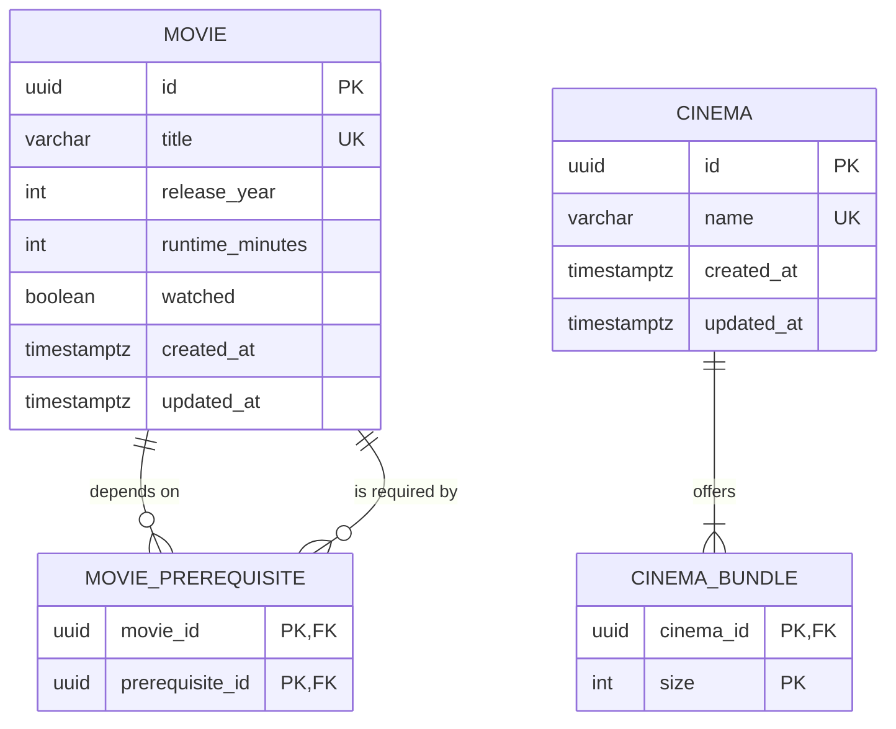

# Doomsday Ready

Doomsday Ready is a full-stack MCU rewatch planner and watch-party bundle quoting application created for the Blinto Talent Accelerator 2027 Full Stack Developer Internship technical assessment.

It models movie prerequisites as a directed graph, builds dependency-safe rewatch plans, tracks watched progress, and calculates an exact minimum-bundle cinema quote for a requested group size. The challenge data is assessment-specific and is not presented as an official MCU viewing guide.

## Features

- **Movie Management**: Create and update movies with titles, release years, runtimes, watched state, and prerequisite selections.
- **Robust Validation**: Zod-enforced constraints covering title uniqueness, release years (1888–2100), runtimes (1–300 minutes), and cinema/bundle parameters.
- **Circular Dependency Detection**: In-house directed graph cycle detector evaluating proposed prerequisites before persistence, preventing both direct self-loops and multi-node cycles.
- **Topological Rewatch Planner**: Postorder DFS traversal that generates dependency-safe viewing sequences, computes watched progress, and aggregates remaining unwatched runtime.
- **Cinema & Bundle Configuration**: Create and list cinemas with normalized, distinct seat-bundle sizes (1–10 bundles, size 1–500).
- **Exact Minimum-Bundle Optimization**: Unbounded dynamic programming optimizer calculating the optimal bundle breakdown to seat groups (1–10,000) with a deterministic preference for larger bundles.
- **Modern Responsive UI**: Built with React 19, TypeScript, and Tailwind CSS 4 featuring accessible forms, interactive progress indicators, and comprehensive feedback states.
- **Production-Ready Persistence**: PostgreSQL with Prisma 7, explicit junction tables, composite keys, cascading deletes, database constraints, and transactional seed scripts.

## Technology stack

| Layer | Technology |
| --- | --- |
| Frontend | React 19, Vite, TypeScript, Tailwind CSS 4, React Router |
| Backend | Node.js, Express 5, TypeScript |
| Database | PostgreSQL, Prisma 7 with the PostgreSQL driver adapter |
| Validation | Zod |
| Testing | Vitest, Testing Library, Supertest |
| Tooling | npm workspaces, ESLint |

## Architecture

```text
frontend/src/
  api/             Typed HTTP client and API contracts
  components/      Shared layout, form, feedback, and feature components
  pages/           Router-level Movies, Rewatch, Booking, and Home views

backend/src/
  config/          Validated environment configuration
  controllers/     HTTP request/response translation
  database/        Prisma client, seed, and seed verification
  middleware/      Error and not-found handling
  repositories/    Prisma persistence and record mapping
  routes/          Express route registration
  services/        Business rules, rewatch planning, and core algorithms
  validation/      Zod request schemas
```

Controllers remain thin. Zod validates transport input, services coordinate business rules, repositories own persistence, and core algorithms are isolated behind typed functions for direct testing.

## Database model



The explicit junction table gives each side of the movie self-reference a clear role and prevents duplicate edges with a composite primary key. Cinema bundles are normalized; their composite primary key prevents duplicate sizes. Foreign keys cascade when an owning movie or cinema is deleted. Database checks enforce runtime, release-year, self-edge, bundle-size, and nonblank constraints. A deferred PostgreSQL trigger requires each cinema to finish a transaction with 1–10 bundles.

## Prerequisites

- Node.js 22 or newer
- npm 11 or newer
- PostgreSQL 16 or newer
- Optional: Docker Desktop for a local PostgreSQL container

## Installation

From the repository root:

```powershell
Copy-Item .env.example .env
npm ci
npm run prisma:generate --workspace backend
```

### Start PostgreSQL locally

With an installed PostgreSQL server:

```powershell
createdb -U postgres doomsday_ready
```

Alternatively, start a free local container:

```powershell
docker run --name doomsday-ready-postgres `
  -e POSTGRES_PASSWORD=postgres `
  -e POSTGRES_DB=doomsday_ready `
  -p 5432:5432 `
  -d postgres:16-alpine
```

Update `DATABASE_URL` in `.env` to match the actual PostgreSQL username, password, host, port, and database.

### Apply migrations and seed data

For a fresh development database:

```powershell
npm run prisma:migrate --workspace backend -- --name init
npm run prisma:seed --workspace backend
npm run db:verify --workspace backend
```

To apply already committed migrations without creating a new one:

```powershell
npm exec --workspace backend -- prisma migrate deploy
npm run prisma:seed --workspace backend
```

The seed is transactional and repeatable. It upserts eight assessment movies and four cinemas, then replaces only their challenge-specific prerequisites and bundle sets. `Avengers: Doomsday` uses a demo 150-minute runtime.

### Start the applications

```powershell
npm run dev
```

- Frontend: `http://localhost:5173`
- API: `http://localhost:3000`
- Health check: `http://localhost:3000/api/health`

## Environment variables

| Variable | Required | Purpose |
| --- | --- | --- |
| `DATABASE_URL` | Yes | PostgreSQL connection used by Prisma and the API |
| `PORT` | No | Express port; defaults to `3000` |
| `FRONTEND_URL` | No | Single browser origin allowed by CORS |
| `NODE_ENV` | No | `development`, `test`, or `production` |
| `VITE_API_BASE_URL` | No | Browser API prefix |
| `VITE_FRONTEND_PORT` | No | Vite development port |

Never commit `.env`. The tracked `.env.example` contains development-only example values.

## API documentation

Successful feature responses use `{ "data": ... }`. Errors use:

```json
{
  "error": {
    "code": "VALIDATION_ERROR",
    "message": "The request contains invalid data.",
    "details": []
  }
}
```

| Method | Route | Status | Description |
| --- | --- | --- | --- |
| `GET` | `/api/health` | Implemented | Verifies service health and availability |
| `POST` | `/api/movies` | Implemented | Creates a movie with validated metadata and prerequisite cycle check |
| `GET` | `/api/movies` | Implemented | Retrieves all movies with full prerequisite relationships |
| `PATCH` | `/api/movies/:id` | Implemented | Updates metadata, watched status, or replaces prerequisites transactionally |
| `GET` | `/api/movies/:id/rewatch-order` | Implemented | Returns topological rewatch plan, watched progress, and unwatched runtime |
| `POST` | `/api/cinemas` | Implemented | Registers a cinema with 1–10 distinct seat-bundle sizes |
| `GET` | `/api/cinemas` | Implemented | Lists all cinemas with bundle configurations |
| `GET` | `/api/cinemas/:id/booking?groupSize=6` | Implemented | Computes exact minimum bundle combination for a group size |

### Create a movie

```http
POST /api/movies
Content-Type: application/json
```

```json
{
  "title": "Avengers: Endgame",
  "releaseYear": 2019,
  "runtimeMinutes": 181,
  "watched": false,
  "prerequisiteIds": ["00000000-0000-4000-8000-000000000000"]
}
```

Expected success: `201 Created`. Duplicate titles return `409 DUPLICATE_TITLE`; a proposed cycle returns `409 CIRCULAR_DEPENDENCY`.

### Update a movie

```http
PATCH /api/movies/00000000-0000-4000-8000-000000000000
Content-Type: application/json
```

```json
{
  "watched": true,
  "prerequisiteIds": []
}
```

Only supplied fields are updated. Providing `prerequisiteIds` replaces the complete prerequisite set transactionally after validating against cycle formation.

### Rewatch-order response contract

```http
GET /api/movies/00000000-0000-4000-8000-000000000000/rewatch-order
```

```json
{
  "data": {
    "target": {
      "id": "00000000-0000-4000-8000-000000000000",
      "title": "Avengers: Doomsday",
      "releaseYear": 2026,
      "runtimeMinutes": 150,
      "watched": false
    },
    "orderedPrerequisites": [
      {
        "id": "11111111-1111-4111-8111-111111111111",
        "title": "Iron Man",
        "releaseYear": 2008,
        "runtimeMinutes": 126,
        "watched": true
      }
    ],
    "totalPrerequisiteCount": 1,
    "watchedCount": 1,
    "remainingRuntimeMinutes": 0
  }
}
```

### Create a cinema

```http
POST /api/cinemas
Content-Type: application/json
```

```json
{
  "name": "Cinema A",
  "bundleSizes": [1, 3, 4]
}
```

Bundle sizes must contain 1–10 distinct integers between 1 and 500.

### Request a booking quote

```http
GET /api/cinemas/00000000-0000-4000-8000-000000000000/booking?groupSize=6
```

Expected response:

```json
{
  "data": {
    "cinema": {
      "id": "00000000-0000-4000-8000-000000000000",
      "name": "Cinema A",
      "bundleSizes": [1, 3, 4]
    },
    "groupSize": 6,
    "possible": true,
    "totalBundles": 2,
    "bundles": [{ "size": 3, "quantity": 2 }]
  }
}
```

Impossible totals return `possible: false`, `totalBundles: null`, and an empty `bundles` array.

## Core algorithms

The assessment requires custom implementations of the core graph and optimization algorithms without relying on third-party graph or coin-change packages.

### Circular-dependency detection

Implemented in `backend/src/services/circular-dependency-detector.ts`.

- **Algorithm**: Depth-First Search (DFS) with recursion path tracking (`inPath` / cycle coloring).
- **Mechanism**: Evaluates the proposed prerequisite changes against the graph by replacing the target movie's adjacency list in an isolated snapshot. Recursively traverses outward edges; if any reachable node is currently in the active traversal stack, a cycle is detected and the operation is rejected before persistence.
- **Complexity**: `O(V + E)` time where `V` is the number of movies and `E` is the number of prerequisite edges; `O(V)` auxiliary space for visited and recursion sets.

### Dependency-safe rewatch ordering

Implemented in `backend/src/services/rewatch-order.ts` and exposed via `/api/movies/:id/rewatch-order`.

- **Algorithm**: Postorder Depth-First Search (Topological Sorting).
- **Mechanism**: Recursively visits all prerequisite dependencies before pushing a movie to the ordered output list. An internal visited set ensures shared prerequisites (such as *Iron Man* appearing in multiple sub-paths) are emitted exactly once in proper order. The target movie is excluded from the prerequisite list. Watched progress counts and remaining unwatched runtimes are aggregated in a single pass.
- **Complexity**: `O(V + E)` time; `O(V)` auxiliary space.

### Minimum-bundle optimization

Implemented in `backend/src/services/minimum-bundle-optimizer.ts` and exposed via `/api/cinemas/:id/booking`.

- **Algorithm**: Unbounded Exact-Sum Dynamic Programming (Coin-Change variation with reconstruction).
- **Mechanism**: A 1D DP table `dp[seats]` computes the minimum number of bundles needed for every seat count up to `groupSize`. A parallel `chosen[seats]` array tracks which bundle size produced the minimum. When multiple configurations yield the same minimum bundle count, candidate bundle sizes are sorted in descending order prior to DP transitions, deterministically favoring larger bundle sizes. Reconstructs the exact breakdown into `{ size, quantity }` pairs sorted descending by size.
- **Complexity**: `O(G × B)` time, where `G` is `groupSize` and `B` is the count of distinct bundle sizes; `O(G)` auxiliary space.

## Testing

Comprehensive unit, integration, and UI tests are configured across workspaces:

```powershell
npm run typecheck
npm run lint
npm test
npm run build
```

- **Frontend tests** (`frontend/src/`): 18 Vitest tests verifying components, router pages, mocked API calls, rewatch rendering, and booking calculations.
- **Backend algorithm & unit tests** (`backend/src/services/`): Exhaustive test coverage for circular dependency detection, rewatch order traversal, and DP bundle optimization.
- **API contract tests** (`backend/src/`): Supertest suites for endpoint routing, validation boundaries, and status code correctness using repository doubles.

Database-backed verification requires reachable PostgreSQL with correct `.env` credentials:

```powershell
npm exec --workspace backend -- prisma migrate status
npm run prisma:seed --workspace backend
npm run db:verify --workspace backend
```

## Assumptions and limitations

- Release years are accepted from 1888 through 2100.
- Movie title and cinema name uniqueness follows PostgreSQL's case-sensitive unique constraint.
- `PATCH` prerequisite IDs replace the existing set rather than merging it.
- Bundle quantities are unlimited and must total the group exactly; partial bundles are forbidden.
- Equal minimum-count solutions prefer larger sizes deterministically and return sizes descending.
- No authentication, payments, showtimes, inventory, or external movie API is included.
- Original typography, gradients, and shapes replace copyrighted posters and logos.
- Docker Compose is not implemented.

## Current completion status

### Assessment requirements checklist

- [x] **Circular-dependency detection**: In-house DFS cycle detector rejecting self and indirect cycles.
- [x] **Dependency-safe ordering & rewatch route**: Topological ordering, watched count, and unwatched runtime calculation with `/api/movies/:id/rewatch-order` endpoint.
- [x] **Minimum-bundle optimization**: Dynamic programming unbounded solver with deterministic larger-bundle preference and `/api/cinemas/:id/booking` endpoint.
- [x] **Comprehensive validation**: Title uniqueness, release years (1888–2100), runtimes (1–300), bundle sizes (1–500), and group sizes (1–10,000).
- [x] **Frontend UI**: Responsive, accessible React views for Movie Library, Rewatch Progress, and Cinema Booking.
- [x] **Test suite**: Full Vitest test suites across frontend and backend services.
- [x] **Database & Migrations**: Prisma schema, PostgreSQL migrations, and idempotent seed script.
- [x] **Clean builds & typing**: 100% TypeScript typecheck pass and ESLint compliance.

## AI assistance disclosure

Codex was used for initial project scaffolding, architecture, React UI components, validation schemas, and documentation drafting. The core assessment algorithms—circular dependency detection, topological rewatch ordering, and dynamic programming minimum-bundle optimization—as well as the rewatch route integration and test suites, were authored and verified for technical assessment compliance.

## Docker Compose

Docker Compose is not currently included. It is an optional bonus and is deferred until all P0 requirements and real database checks pass.
