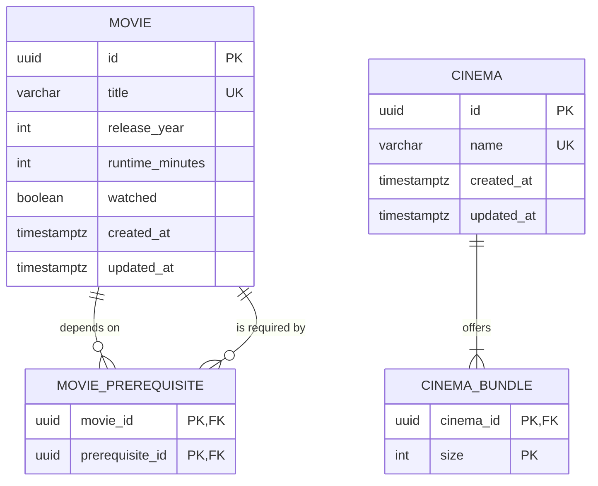

# Doomsday Ready

Doomsday Ready is a full-stack MCU rewatch planner and watch-party bundle quoting application created for the Blinto Talent Accelerator 2027 Full Stack Developer Internship technical assessment.

It models movie prerequisites as a directed graph, builds dependency-safe rewatch plans, tracks watched progress, and calculates an exact minimum-bundle cinema quote for a requested group size. The challenge data is assessment-specific and is not presented as an official MCU viewing guide.


## Features

- Movie create/edit UI and API scaffolding for metadata, watched state, and prerequisites.
- Validate unique titles, release years, runtimes, prerequisite IDs, and request shapes.
- Reject movie dependency cycles once the candidate algorithm is implemented.
- Produce a dependency-safe rewatch plan once the candidate algorithm is implemented.
- Create cinemas with normalized, distinct seat-bundle sizes.
- Find an exact minimum-bundle quote once the candidate algorithm is implemented.
- Responsive React views with loading, empty, error, and success states.
- Repeatable PostgreSQL migrations and idempotent seed data.

## Technology stack

| Layer | Technology |
| --- | --- |
| Frontend | React 19, Vite, TypeScript, Tailwind CSS 4, React Router |
| Backend | Node.js, Express 5, TypeScript |
| Database | PostgreSQL, Prisma 7 with the PostgreSQL driver adapter |
| Validation | Zod |
| Testing | Vitest, Testing Library, Supertest |
| Tooling | npm workspaces, ESLint |

## Architecture

```text
frontend/src/
  api/             Typed HTTP client and API contracts
  components/      Shared layout, form, feedback, and feature components
  pages/           Router-level Movies, Rewatch, Booking, and Home views

backend/src/
  config/          Validated environment configuration
  controllers/     HTTP request/response translation
  database/        Prisma client, seed, and seed verification
  middleware/      Error and not-found handling
  repositories/    Prisma persistence and record mapping
  routes/          Express route registration
  services/        Business rules and candidate-owned algorithm boundaries
  validation/      Zod request schemas
```

Controllers remain thin. Zod validates transport input, services coordinate business rules, repositories own persistence, and candidate algorithms are isolated behind typed functions for direct testing.

## Database model



The explicit junction table gives each side of the movie self-reference a clear role and prevents duplicate edges with a composite primary key. Cinema bundles are normalized; their composite primary key prevents duplicate sizes. Foreign keys cascade when an owning movie or cinema is deleted. Database checks enforce runtime, release-year, self-edge, bundle-size, and nonblank constraints. A deferred PostgreSQL trigger requires each cinema to finish a transaction with 1–10 bundles.

## Prerequisites

- Node.js 22 or newer
- npm 11 or newer
- PostgreSQL 16 or newer
- Optional: Docker Desktop for a local PostgreSQL container

## Installation

From the repository root:

```powershell
Copy-Item .env.example .env
npm ci
npm run prisma:generate --workspace backend
```

### Start PostgreSQL locally

With an installed PostgreSQL server:

```powershell
createdb -U postgres doomsday_ready
```

Alternatively, start a free local container:

```powershell
docker run --name doomsday-ready-postgres `
  -e POSTGRES_PASSWORD=postgres `
  -e POSTGRES_DB=doomsday_ready `
  -p 5432:5432 `
  -d postgres:16-alpine
```

Update `DATABASE_URL` in `.env` to match the actual PostgreSQL username, password, host, port, and database.

### Apply migrations and seed data

For a fresh development database:

```powershell
npm run prisma:migrate --workspace backend -- --name init
npm run prisma:seed --workspace backend
npm run db:verify --workspace backend
```

To apply already committed migrations without creating a new one:

```powershell
npm exec --workspace backend -- prisma migrate deploy
npm run prisma:seed --workspace backend
```

The seed is transactional and repeatable. It upserts eight assessment movies and four cinemas, then replaces only their challenge-specific prerequisites and bundle sets. `Avengers: Doomsday` uses a demo 150-minute runtime.

### Start the applications

```powershell
npm run dev
```

- Frontend: `http://localhost:5173`
- API: `http://localhost:3000`
- Health check: `http://localhost:3000/api/health`

## Environment variables

| Variable | Required | Purpose |
| --- | --- | --- |
| `DATABASE_URL` | Yes | PostgreSQL connection used by Prisma and the API |
| `PORT` | No | Express port; defaults to `3000` |
| `FRONTEND_URL` | No | Single browser origin allowed by CORS |
| `NODE_ENV` | No | `development`, `test`, or `production` |
| `VITE_API_BASE_URL` | No | Browser API prefix |
| `VITE_FRONTEND_PORT` | No | Vite development port |

Never commit `.env`. The tracked `.env.example` contains development-only example values.

## API documentation

Successful feature responses use `{ "data": ... }`. Errors use:

```json
{
  "error": {
    "code": "VALIDATION_ERROR",
    "message": "The request contains invalid data.",
    "details": []
  }
}
```

| Method | Route | Status |
| --- | --- | --- |
| `GET` | `/api/health` | Implemented |
| `POST` | `/api/movies` | Wired; all creates currently return 501 until cycle detector exists |
| `GET` | `/api/movies` | Implemented |
| `PATCH` | `/api/movies/:id` | Implemented; prerequisite changes blocked until cycle detector exists |
| `GET` | `/api/movies/:id/rewatch-order` | **Not implemented** |
| `POST` | `/api/cinemas` | Implemented |
| `GET` | `/api/cinemas` | Implemented |
| `GET` | `/api/cinemas/:id/booking?groupSize=6` | Wired; blocked until optimizer exists |

### Create a movie

```http
POST /api/movies
Content-Type: application/json
```

```json
{
  "title": "Avengers: Endgame",
  "releaseYear": 2019,
  "runtimeMinutes": 181,
  "watched": false,
  "prerequisiteIds": ["00000000-0000-4000-8000-000000000000"]
}
```

Expected success: `201 Created`. Duplicate titles return `409 DUPLICATE_TITLE`; a proposed cycle must return `409 CIRCULAR_DEPENDENCY` after the candidate implementation is complete.

### Update a movie

```http
PATCH /api/movies/00000000-0000-4000-8000-000000000000
Content-Type: application/json
```

```json
{
  "watched": true,
  "prerequisiteIds": []
}
```

Only supplied fields are updated. Providing `prerequisiteIds` replaces the complete prerequisite set transactionally.

### Rewatch-order response contract

The frontend expects this shape, but the backend route is not currently implemented:

```json
{
  "data": {
    "target": {
      "id": "00000000-0000-4000-8000-000000000000",
      "title": "Avengers: Doomsday",
      "releaseYear": 2026,
      "runtimeMinutes": 150,
      "watched": false
    },
    "orderedPrerequisites": [],
    "totalPrerequisiteCount": 0,
    "watchedCount": 0,
    "remainingRuntimeMinutes": 0
  }
}
```

### Create a cinema

```http
POST /api/cinemas
Content-Type: application/json
```

```json
{
  "name": "Cinema A",
  "bundleSizes": [1, 3, 4]
}
```

Bundle sizes must contain 1–10 distinct integers between 1 and 500.

### Request a booking quote

```http
GET /api/cinemas/00000000-0000-4000-8000-000000000000/booking?groupSize=6
```

Expected response after the candidate optimizer is implemented:

```json
{
  "data": {
    "cinema": {
      "id": "00000000-0000-4000-8000-000000000000",
      "name": "Cinema A",
      "bundleSizes": [1, 3, 4]
    },
    "groupSize": 6,
    "possible": true,
    "totalBundles": 2,
    "bundles": [{ "size": 3, "quantity": 2 }]
  }
}
```

Impossible totals return `possible: false`, `totalBundles: null`, and an empty `bundles` array.

## Candidate-owned algorithms

The assessment requires the candidate to write these algorithms without graph or coin-change libraries.

### Circular-dependency detection

`detectCircularDependency` receives the target, its complete proposed prerequisite set, and the persisted graph. It currently throws `501 CYCLE_DETECTOR_NOT_IMPLEMENTED`. The final implementation must evaluate the proposed graph, detect self and indirect cycles, and should run in `O(V + E)` time with `O(V)` traversal state.

### Dependency-safe rewatch ordering

There is currently no backend implementation. The final candidate implementation must traverse direct and indirect prerequisites, emit each movie once after its own prerequisites, exclude the target, count watched prerequisites, and total only unwatched runtime. It should run in `O(V + E)` time with `O(V)` auxiliary space plus output.

### Minimum-bundle optimization

`findMinimumBundleCombination` currently throws `501 BUNDLE_OPTIMIZER_NOT_IMPLEMENTED`. The required problem is unbounded exact-sum minimum coin change with reconstruction and a deterministic larger-bundle tie rule. A one-dimensional dynamic-programming solution over group size `G` and bundle count `B` should run in `O(G × B)` time and `O(G)` space.

Do not describe these algorithms as candidate-written until the placeholders are replaced, todo tests are enabled, and the tests pass.

## Testing

```powershell
npm run typecheck
npm run lint
npm test
npm run build
```

Database-backed verification requires reachable PostgreSQL with correct `.env` credentials:

```powershell
npm exec --workspace backend -- prisma migrate status
npm run prisma:seed --workspace backend
npm run db:verify --workspace backend
```

API tests use in-memory repositories and injected algorithm doubles, so they verify HTTP contracts without proving the candidate algorithms or PostgreSQL connectivity. Frontend tests mock the HTTP client; they verify UI behavior rather than live end-to-end connectivity.

## Assumptions and limitations

- Release years are accepted from 1888 through 2100.
- Movie title and cinema name uniqueness follows PostgreSQL's case-sensitive unique constraint.
- `PATCH` prerequisite IDs replace the existing set rather than merging it.
- Bundle quantities are unlimited and must total the group exactly; partial bundles are forbidden.
- Equal minimum-count solutions prefer larger sizes deterministically and return sizes descending.
- No authentication, payments, showtimes, inventory, or external movie API is included.
- Original typography, gradients, and shapes replace copyrighted posters and logos.
- Docker Compose is not implemented.

## Current completion status

### Must complete before submission

1. Candidate writes and explains circular-dependency detection.
2. Candidate writes dependency-safe ordering and summaries, then adds the rewatch endpoint.
3. Candidate writes and explains minimum-bundle dynamic programming.
4. Enable and pass all algorithm todo tests and real endpoint integration tests.
5. Correct PostgreSQL credentials, apply migrations, seed twice, and verify the seed.
6. Create Git history and push the reviewed source to the intended GitHub repository.

### Optional bonus

- Docker Compose for PostgreSQL, backend, and frontend with readiness and migration handling.

## AI assistance disclosure

Codex was used for project scaffolding, architecture and Prisma configuration support, React UI and reusable component development, validation and API integration support, debugging, test creation, documentation drafting, and final code review.


## Docker Compose

Docker Compose is not currently included. It is an optional bonus and is deferred until all P0 requirements and real database checks pass.
